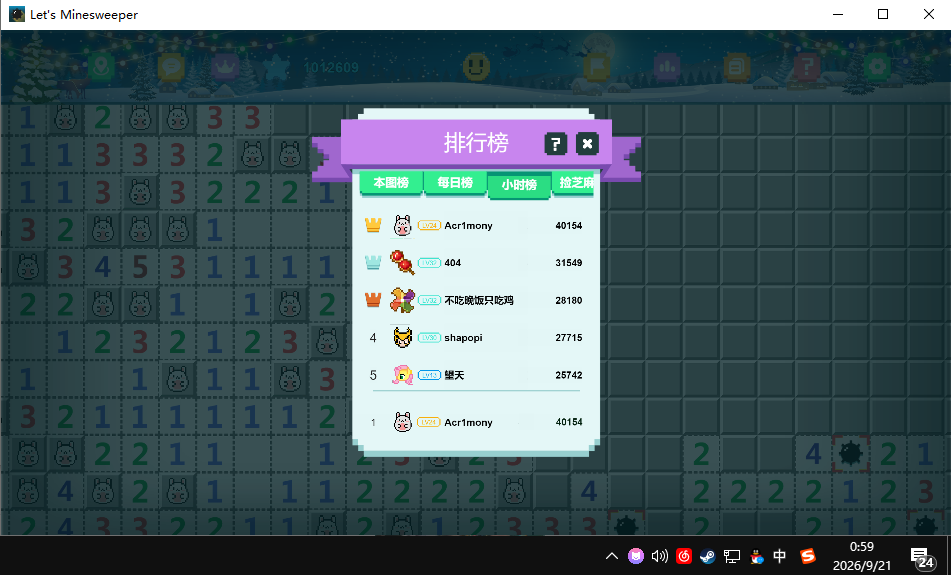

# Let's Minesweeper 自动扫雷助手

看屏幕、按规则推理、替你点击。**完全离线，不读游戏内存，不做概率猜雷。**

适用游戏：Windows 版《Let's Minesweeper》（一起来扫雷）。

---

## 这是什么

《Let's Minesweeper》和传统扫雷最大的区别是**地图极大**：一屏放不下，必须按住左键拖动视口才能看到其他区域。所以它既没有固定棋盘坐标，也没有能一眼看全的局面。

本程序解决的就是这件事：截取游戏窗口当前的可见画面，校准出棋盘网格，识别每一格的状态和数字，用本地规则推理出「哪些格一定安全、哪些格一定是雷」，再模拟鼠标替你点下去；当前视口没有可做的事时，就拖动视口去探索新的区域。

它只处理**当前可见视口**，不尝试拼出或保存整张地图。

### 它不会做的事

| 不会 | 说明 |
| --- | --- |
| 读内存 / 改数据 | 只用屏幕截图，和你看的是同一份画面 |
| 联网 / 上传 | 全程离线，没有任何网络请求 |
| 猜雷 | 只输出在所有可能解中取值相同的格子；推不出来就换区，不赌概率 |
| 注入 / 改游戏文件 | 只发送标准鼠标输入 |

---

## 三步开始

1. **打开游戏**：启动《Let's Minesweeper》，把窗口还原成普通大小，让棋盘完整可见（不要被其他窗口遮挡）。
2. **启动助手**：双击 `dist/LetsMinesweeperBot.exe`。出现 UAC 提示时选「是」（模拟鼠标输入需要管理员权限）。
3. **按 `F8` 开始**。再按一次 `F8` 立即急停。

不需要安装 Python，不需要配置任何参数——格距、棋盘位置、缩放比例都是自动校准的。

---

## 它能做什么

### 识别

- **自动校准网格**：格距在 20–72 像素之间自动搜索，改窗口大小、改系统缩放、游戏内放大缩小都不用重新调参；专门的倍频防护避免把「两格当一格」。
- **小窗口也能用**：窗口不小于 200×160 像素、可见完整格不少于 6×4 时即可校准。
- **数字 1–8**：颜色直接取自游戏自带的数字贴图，7 和 8 与 1–6 同等可靠；小格距下的抗锯齿留了余量，不会因为字细就看错。
- **已标雷**：灰格上出现任何图形都按游戏规则判为地雷——小旗、笑脸、猫脸等不同标记皮肤，以及铺满整格的图标都能识别。
- **宝箱**：识别黄色宝箱，并区分「开启」与「关闭」两种外观。
- **已打开的雷**：识别并计入周围数字的雷数约束。

### 推理

- 基础扫雷规则 + 集合差分：直接从数字推安全格与地雷。
- 规则穷尽后，对剩余约束做**有界穷举**（节点预算 400），能解出 `1-2-1` 这类重叠模式中的确定性格子。
- **只输出确定性结论**：某格在所有一致解里都是雷，才标雷；都是安全，才开格。穷举超时就安全放弃，不硬算、不猜。

### 操作

- 连续批量右键标旗，再连续批量左键开格，减少鼠标来回移动。
- 点击带按键保持与间隔、拖动分多步完成，降低游戏漏收输入的概率。
- 拖动后等待画面稳定再重新校准，拖动过程中的中间帧不参与识别。
- 沿未开区域边缘顺时针探索，尽量让已开格与未开格各占视口一半。
- **视口轨迹缓存**：按每次拖动的实际像素位移推算位置，选方向时避开已经探过的区域。
- **防卡死脱困**：检测到连续 8 次反向往复或连续 4 次同向绕圈时，向评分最高的方向连续移动 8 次脱困；脱困后有 4 步承诺期，不会立刻原路退回刚离开的区域。
- **视口清空**：先沿最后一次开格/标雷方向探一步，再进入顺时针探索；连续 5 分钟没发现未开格才结束运行。
- **识别异常自恢复**：最多 8 次恢复拖动（先静置重读，再换区）。
- **踩雷自动复活**：识别到死亡对话框后等待倒计时结束，点击屏幕中央的绿色【复活】。
- **自动开宝箱**：点击关闭的宝箱，依次确认「福利宝箱」和奖励对话框，每次确认后验证对话框确实关闭；连续 3 次失败自动停用该功能。
- **拖不动不崩**：可拖动空间不足时改用盲拖继续，而不是整轮停机。

### 界面

- 深色战术台，左侧画面 + 识别覆层，右侧安全格 / 待标雷 / 未开格 / 累计统计。
- 默认**不**勾选「每秒自动刷新」，需要时手动开启，避免持续占用 CPU。
- `F8` 启动与急停切换，长按只触发一次；观察状态下按 `F8` 直接开始自动扫雷。
- 累计开格 / 标旗持久化，重启不清零；只有点「清除统计」才归零。
- 截图与识别在后台线程执行，界面不卡。

---

## 覆层颜色

| 颜色 | 含义 |
| --- | --- |
| 蓝色框 | 确定安全，可以开格 |
| 红色框 | 逻辑推导出的待标雷 |
| 绿色框 | 画面中已经带图形确认的雷 |
| 深红色框 | 已经打开的雷，不会再次操作 |
| 金色框 | 黄色宝箱（安全） |
| 紫色框 | 无法识别，程序不会依据它点击或标雷 |

看到紫色框说明遇到了没见过的图形素材：这时保持观察模式，用 `tools/capture_window.py` 抓一张样本。

---

## 一次自动扫雷的循环

```text
截图当前视口
   |
   +-- 校准网格 -> 逐格识别 -> 局部约束求解
   |
   +-- 这一轮有确定操作？
   |      是 -> 批量标旗 -> 批量开格 -> 等动画与加分文字消失 -> 回到「截图」
   |      否 -> 按导航策略拖动视口 -> 等画面稳定 -> 回到「校准网格」
   |
   +-- 识别矛盾 / 网格异常 -> 本轮一次点击都不发，只做恢复
```

---

## 安全设计

- 拖动过程中不把中间截图交给识别器，鼠标释放并确认稳定后才重新校准。
- 识别出现矛盾或网格异常时，这一轮**一次点击都不发**。
- 恢复时先静置约半秒重读当前画面（让浮动加分文字自行消失），仍异常才拖动换区；连续失败会丢弃格距缓存、强制全量重新校准。
- 复活与宝箱检测基于对话框的实心色块特征（青白底、亮绿按钮、琥珀色确认块），正常棋盘不会误触发。
- `F8` 可以打断点击批次和拖动过程，拖动中会先释放左键。

---

## 运行要求

- Windows 10 / 11，屏幕处于解锁状态。
- 游戏窗口可见；如果走的是屏幕截图后备路径，不能被其他窗口遮挡。
- 助手与游戏**权限级别相同**，推荐都以管理员身份运行。

---

## 从源码运行 / 自己打包

环境：Python 3.10+（含 Tkinter）、Pillow、NumPy、OpenCV-Python。

```powershell
pip install -r requirements.txt
python .\app.py          # 或双击 start-minesweeper-bot.cmd
```

打包单文件 exe（输出到 `dist\LetsMinesweeperBot.exe`）：

```powershell
.\build_exe.cmd
```

等价于：

```powershell
python -m PyInstaller --noconsole --onefile --uac-admin --clean --name LetsMinesweeperBot app.py
```

---

## 数据与隐私

- 唯一的本地文件是统计存档 `statistics.json`：`{ "opened": 开格数, "flagged": 标旗数 }`。
- exe 运行时读写 exe 同目录的 `data\statistics.json`（跟着 exe 走）；源码运行时用项目根目录的 `data\statistics.json`。两者互不影响。
- 除统计数字外不落盘任何内容：截图只在内存里处理，不保存、不上传。

---

## 常见问题

| 现象 | 原因与处理 |
| --- | --- |
| 双击后弹出 UAC | 正常。模拟鼠标输入需要管理员权限，选「是」 |
| SmartScreen 拦截 | 程序未签名，点「更多信息 → 仍要运行」 |
| 报 `WinError 5` | 权限不足，以管理员身份运行，或让游戏也提权 |
| 提示游戏窗口过小 | 窗口至少 200×160 像素，且要露出至少 6×4 个完整格子 |
| 提示可见格子数量不足 | 同上：把窗口调大，或让棋盘完整进入视口 |
| 提示识别异常并反复拖动 | 有没见过的图形素材。保持观察模式抓样本，再补识别规则 |
| 一分钟找不到可开区域 | 按提示 `F8` 停止，手动把游戏换到新区域后继续 |
| 状态栏显示「脱困移动中」 | 正在主动跳出死循环，等到 8 次结束会自动继续 |
| 点击没反应 | 游戏和助手权限不一致，或游戏窗口被别的窗口盖住 |
| 想立刻停手 | 按 `F8`，或在界面点「暂停」 |

---

## 项目结构

```text
lets-minesweeper-bot/
├─ app.py                     # 战术台界面与程序入口
├─ minesweeper/
│  ├─ capture.py              # 窗口截图（PrintWindow，失败回落到屏幕截图）
│  ├─ geometry.py             # 棋盘网格校准
│  ├─ recognition.py          # 格子与特殊素材识别
│  ├─ solver.py               # 局部约束求解
│  ├─ automation.py           # 自动循环、导航、对话框与恢复逻辑
│  ├─ dialogs.py              # 死亡 / 复活 / 福利宝箱 / 奖励对话框检测
│  ├─ input_control.py        # 鼠标点击、拖动、F8 热键
│  ├─ observer.py             # 观察、稳定检测、覆层绘制
│  └─ statistics.py           # 累计统计持久化
├─ tests/                     # 离线单元测试
├─ tools/                     # 截图采集、样本分析、游戏素材提取
├─ docs/game-assets.md        # 游戏自带棋盘素材目录（数字色表、标记皮肤、未开瓦片）
├─ samples/                   # 本地截图与识别结果样本
├─ data/statistics.json       # 累计统计
├─ build_exe.cmd              # 打包脚本
├─ requirements.txt
├─ shice.png                  # 实际运行效果图
└─ README.md
```

---

## 测试

全部测试离线运行，用真实截图样本 + 手工构造的棋盘，不依赖游戏进程：

```powershell
python -m unittest discover -s .\tests -v
python -m compileall -q .\app.py .\minesweeper .\tests
```

当前 **92 项测试全部通过**，覆盖：格子与数字（含 7/8 与小格距抗锯齿）、标记皮肤、宝箱开合、已开雷、1-2-1 与重叠约束穷举、穷举不输出猜测、三类对话框互不误判、宝箱完整领取流程、拖动期间不识别、顺时针导航、比例救援、孤岛脱困、视口清空探索、轨迹避重、往复/绕圈检测与评分化脱困、承诺期反向否决、8 次恢复拖动、统计持久化，以及网格校准（默认尺寸、放大缩小、倍频防护、小窗口下限）。

---

## 已知限制

- 只支持 Windows，只针对《Let's Minesweeper》当前版本的画面风格。
- 只处理当前视口，不做全局地图推理；推理范围仅限视口内、且忽略最外一圈数字（视口边缘的数字有看不见的邻居）。
- 新版本游戏如果换了美术素材，需要补识别规则——先抓样本，再改 `minesweeper/recognition.py`。
- 游戏窗口移动、缩放或被遮挡后需要重新校准（自动完成，但会中断当前一轮）。

---

## 效果图



---

## 许可与免责

仅供学习与个人离线使用。程序只模拟鼠标输入，不修改游戏数据；在联机或带排行榜的场合使用可能违反游戏规则，请自行判断并承担后果。

项目主页：<https://github.com/Acr1mony/letsminesweeper-bot>
